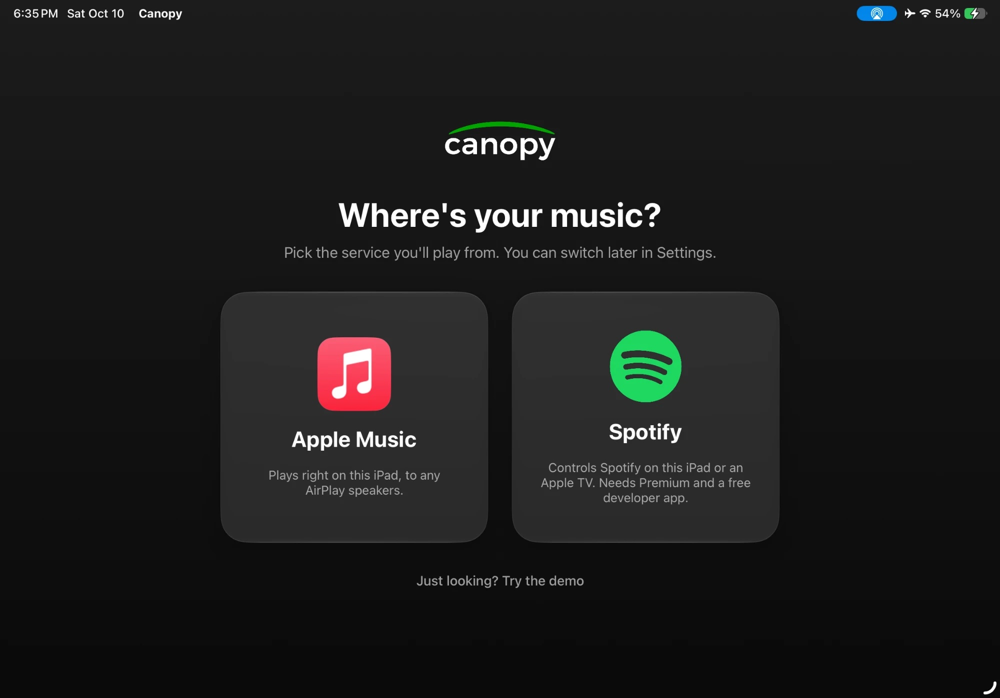
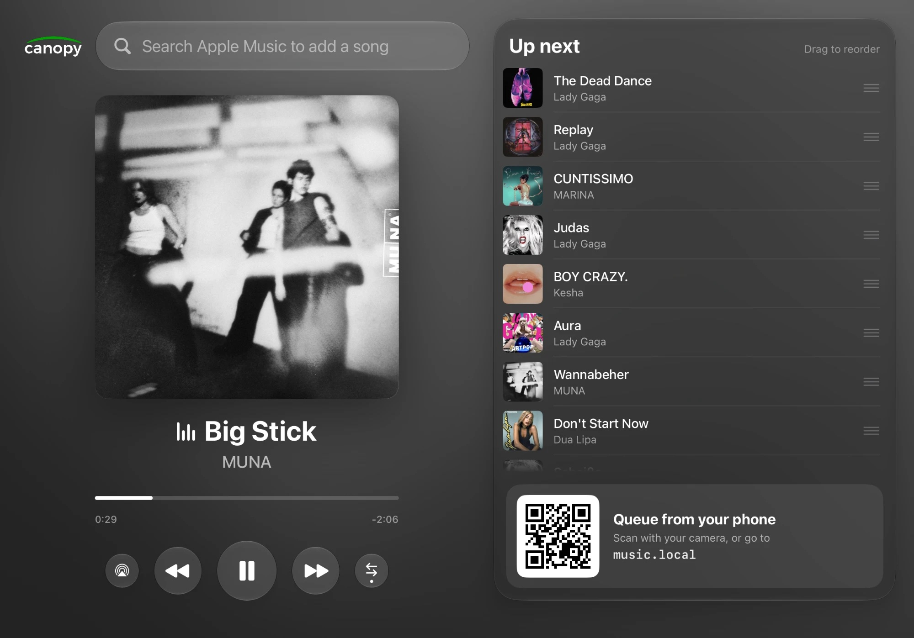
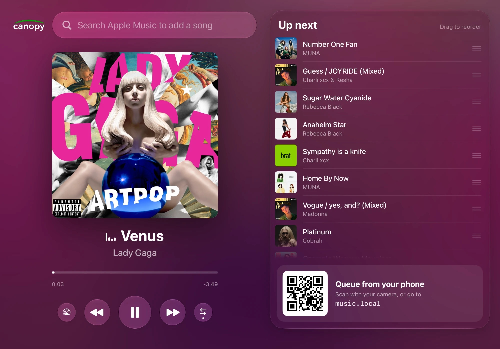
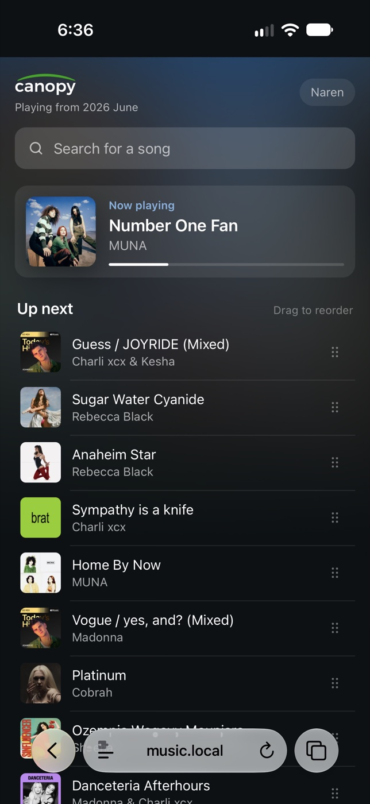

# Canopy Music

iPad party jukebox for Apple Music or Spotify. Pick a base playlist, lock the iPad into a now-playing screen, and guests queue songs on the iPad or from their phones (QR code; guests don't need a music account). Requests and playlist songs live in one list that anyone can drag to reorder.

<p align="center">
  
  
</p>
<p align="center">
  
  
</p>

Privacy: Canopy has no servers, accounts or tracking. See the [privacy policy](PRIVACY.md).

## License

The code is under the [PolyForm Noncommercial License 1.0.0](LICENSE.md): you can use, change and share it for noncommercial purposes. Commercial use needs permission. The Canopy name, logo and app icon aren't covered by the license, and neither are the Apple Music and Spotify marks, which belong to Apple and Spotify.

## Building it for your iPad

Requires Xcode 26+ and an iPad on iPadOS 26+.

1. Open `CanopyMusic.xcodeproj`. Under the CanopyMusic target's **Signing & Capabilities**, choose your team and change the bundle identifier to something you own (e.g. `com.yourname.Canopy`).
2. Build to your iPad once so Xcode registers the App ID.
3. **For Apple Music:** in the [developer portal](https://developer.apple.com/account/resources/identifiers/list), open your App ID → **App Services** tab → check **MusicKit** → save. Without it, Apple Music requests fail with `developerTokenRequestFailed`. It can take a few minutes to take effect.
4. **For Spotify:** see [Spotify](#spotify) below.

The simulator can't play Apple Music or Spotify, so use **Demo** (Settings → Music service): fake songs, 30-second tracks, no audio.

## Running a party

1. In host mode, pick the base playlist (**Choose playlist** / **Change**). The shuffle button reshuffles it.
2. Pick speakers with the **Speakers** row (AirPlay).
3. Press **Start**. It begins playback and locks into the party screen.
4. Triple-click the top button to turn on Guided Access so guests can't leave the app.
5. To get back to host mode, press and hold the Canopy logo (asks for the PIN if you set one in Settings).

## Phones

The iPad runs a small web server on your Wi-Fi so guests can search and queue from their phones. Turn it off with **Settings → Queue from phones**.

- The QR code always uses the iPad's IP address, so it works on any phone.
- The iPad also announces `music.local` over Bonjour (change the name in Settings). Some Android phones don't resolve `.local` names; the QR code covers them.
- It listens on port 80 when it can, so the URL has no `:port` (falls back to 8080).

Guests can add songs, drag to reorder, and remove their own requests. Names are optional. **Settings → Reorder from phones** turns off dragging for guests.

**Host Control:** scan the QR code in **Settings → Host Control** with your own phone to get play/pause, previous, next, reordering and deleting from it. The phone keeps that access (a switch next to your name flips between host and guest view) until you tap **Forget All**.

## Spotify

Spotify only lets each developer app have **5 user accounts** in Development Mode, so every host needs their own (free) developer app. Spotify **Premium** is required.

1. Go to the [Spotify developer dashboard](https://developer.spotify.com/dashboard) and log in with the Spotify account you'll use at parties.
2. **Create app**:
   - **App name / description:** anything (e.g. Canopy).
   - **Redirect URI:** `canopy-music://spotify-callback` (exactly this; click **Add**).
   - **Which API/SDKs:** check **Web API**.
   - Accept the terms and save.
3. Open the app's **Settings** and copy the **Client ID**. No client secret is needed.
4. Under **User Management**, add the email of each Spotify account that will sign in (yours, plus up to 4 others).
5. In Canopy: **Settings → Music service → Spotify**, paste the **Client ID**, tap Done.
6. Open the **Spotify app** on the iPad or another device in your home (TV, game console, speaker, computer). Spotify only lists devices with the app open.
7. In host mode: **Sign in to Spotify**, then tap the device row and choose **where music should play**. Start stays disabled until that device is available.

How it works and what to expect:

- Canopy can't stream Spotify audio itself. It controls a Spotify player (the Spotify app on the iPad, a TV, or another Spotify Connect device) through the Web API. Audio comes out wherever that device plays. When it's the iPad's Spotify app, pick AirPlay speakers with the Speakers row; for other devices Canopy hides it.
- Spotify's queue can only be added to, so Canopy hands Spotify the next song about 20 seconds before the current one ends; it shows as locked from then on.
- Only playlists you own or collaborate on can be base playlists (Development Mode can't read other playlists). Copy an editorial playlist into your library first.
- If the Spotify app is paused for a long time, iPadOS may suspend it and the device disappears. Open Spotify again; host mode shows the device as not available until then.
- Crossfade is set in the Spotify app, not in Canopy.
- Settings shows how many Spotify requests Canopy has made, since Development Mode has an unpublished request quota.

## Layout

```
CanopyKit/                   Swift package (no MusicKit or Spotify code)
  Sources/CanopyCore/        Track, QueueState (all queue rules), PartySession, provider protocols, demo provider
  Sources/CanopyServer/      LAN web server (FlyingFox), mDNS name, web app in Web/
  Sources/CanopyDevServer/   `swift run CanopyDevServer`: phone web app + demo data on your Mac
  Tests/CanopyCoreTests/     queue and session tests
CanopyMusic/                 iPad app (SwiftUI, iPadOS 26)
  AppleMusic/                MusicKit catalog + ApplicationMusicPlayer engine
  Spotify/                   Spotify sign-in, Web API client, catalog and Connect engine
  Views/                     host, party (locked), Up Next, search, fly-in animation
```

```bash
cd CanopyKit && swift test
```

Debug launch arguments: `-autoParty` starts a demo party and locks; `-autoSearch <term>` searches and adds the first result; `-autoLoad`, `-autoResume`, `-autoPrevious`, `-autoStress`, `-showSettings`, `-showPicker`, `-appleMusicState ready|unsynced|nosub|denied`, `-benchAppleMusic`, `-qrGallery` and `-diagnoseMusicKit` exist for testing specific paths.
